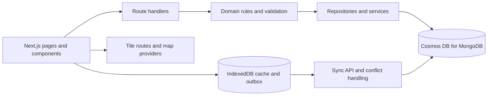

# GeoPin

GeoPin is a GIS field-survey platform for civil engineering, urban planning, and architecture teams. It captures points and parcel perimeters, collects configurable field data, supports offline work, and synchronizes records with a central workspace.

**Project guide:** [interactive documentation route](/docs) · [Spanish README](tradme_es.md)

## Contents

- [Capabilities](#capabilities)
- [Technology](#technology)
- [Architecture](#architecture)
- [Data model](#data-model)
- [Key decisions](#key-decisions)
- [Routes](#routes)
- [API routes](#api-routes)
- [Project layout](#project-layout)
- [Configuration](#configuration)
- [Development commands](#development-commands)
- [Maintenance notes](#maintenance-notes)

## Capabilities

- Map-based parcel capture using device GPS, draggable points, and editable GeoJSON polygons.
- Dynamic capture forms generated from published module schemas.
- Offline cache and outbox backed by IndexedDB, with retries and conflict reporting.
- Parcel search, filtering, editing, review state, and data export.
- Campaign management and progress, service-coverage, and density dashboards.
- CSV/Excel import with duplicate analysis and conflict resolution.
- Role-aware access for surveyors and administrators.
- Map layer selection and optional offline tile downloads.

## Technology

| Area | Stack |
| --- | --- |
| Web | Next.js 16 App Router, React 19, TypeScript |
| UI | Tailwind CSS 4, shadcn/ui, Base UI, Lucide, tailwind-animations |
| Mapping | Leaflet and React Leaflet, GeoJSON |
| Server | Next.js route handlers, Better Auth |
| Persistent data | MongoDB driver against Cosmos DB for MongoDB |
| Offline data | IndexedDB through Dexie, Serwist service worker |
| Import/export | CSV utilities and `xlsx`; GeoJSON and shapefile builders |

## Architecture



The interactive version of this diagram, collection browser, decision notes, and route index live at [`/docs`](http://localhost:3000/docs).

## Data model

### MongoDB collections

| Collection | Document purpose | Important fields / indexes |
| --- | --- | --- |
| `parcelas` | A captured point or parcel, including module data | `_id` mirrors business `id`; GeoJSON `ubicacion`, optional `geometria`, GPS provenance, status, campaign, `modulos`, optimistic versions, timestamps and authorship. Indexes: `ubicacion` 2dsphere, sparse unique `codigo`, `estado`, `levantamientoId`, `creadoEn`, `creadoPor`. |
| `schemas` | One published dynamic form schema per module | `_id` mirrors `moduleId`; module, schema version, field definitions, publication time and author. Index on `modulo`. |
| `levantamientos` | A survey campaign and its expected record count | `_id` mirrors `id`; name, city, expected total, creator and creation time. Index on `ciudad`. |
| `user` | Better Auth accounts | Better Auth managed. GeoPin uses the account role for authorization. |
| `session` | Better Auth sessions | Better Auth managed. |

The exact index declarations are maintained in `lib/server/collections.ts`. Cosmos DB for MongoDB deployments can differ in supported index options; index creation reports individual failures and continues with other indexes.

### Parcel document sketch

```json
{
  "_id": "parcel-id",
  "id": "parcel-id",
  "nombre": "Parcel 01",
  "ubicacion": { "type": "Point", "coordinates": [-66.90, 10.48] },
  "geometria": { "type": "Polygon", "coordinates": [] },
  "gps": { "fuente": "sensor", "precision": 8 },
  "estado": "pendiente",
  "levantamientoId": "campaign-id",
  "modulos": {
    "infraestructura": {
      "version": 1,
      "schemaVersion": 2,
      "datos": { "estado_vial": "regular" }
    }
  },
  "version": 1,
  "creadoEn": "ISO-8601",
  "creadoPor": "user@example.org"
}
```

Coordinates follow GeoJSON order: `[longitude, latitude]`. Locally, IndexedDB stores cached parcels and schemas plus pending outbox entries; it is a sync buffer, not the server's source of truth.

## Key decisions

### Why MongoDB rather than PostgreSQL?

The deployed persistence layer is Cosmos DB for MongoDB, and GeoPin's current capture model fits document storage: module values are configurable, schema versions travel with a parcel's module data, and each captured feature can be written as one document. GeoJSON fields and a `2dsphere` index support spatial lookups. Using the parcel ID as `_id` also makes retries in the offline sync path naturally idempotent. Better Auth uses the same MongoDB client.

This is a description of the current architecture, not a benchmark claim. The trade-offs are explicit: dynamic documents need application-level validation; Cosmos Mongo API capabilities vary by RU and vCore products; PostgreSQL with PostGIS would be a strong option for relational reporting, constraints, and SQL analytics. Moving to PostgreSQL would require replacing the persistence adapter, auth storage, spatial/index definitions, and migration/sync logic.

### Other important choices

- **Offline-first capture:** IndexedDB plus an outbox protects work during network loss. Backoff and per-module versions reduce collisions on retry.
- **Optimistic concurrency:** parcel and module versions make concurrent edits detectable without locking an entire survey.
- **Configurable fields:** published schemas define field types and validation; capture records keep the schema version used at collection time.
- **Mobile-first field UI:** the map remains the primary mobile surface, with floating actions and a form sheet; desktop uses a persistent side panel.
- **Interface theme:** the UI supports light/dark tokens while map tiles retain a light cartographic surface.

## Routes

| Path | Purpose | Access |
| --- | --- | --- |
| `/` | Product landing page | Public |
| `/login` | Sign in | Public; signed-in users are redirected |
| `/campo` | GIS capture and polygon editing | Signed-in user |
| `/listado` | Parcel list, filters, edits, status and exports | Signed-in user; server limits non-admins to their records where applicable |
| `/admin/dashboard` | Campaign progress and spatial/service analytics | Admin permission `levantamiento:gestionar` |
| `/admin/levantamientos` | Create and manage campaigns | Admin permission `levantamiento:gestionar` |
| `/admin/usuarios` | Accounts, roles and account status | Admin permission `usuarios:gestionar` |
| `/admin/esquema` | Configure published capture schemas | Admin permission `esquema:editar` |
| `/admin/importar` | Import CSV/Excel and resolve duplicates | Admin permission `importar:ejecutar` |
| `/perfil` | Update account name and password | Signed-in user |
| `/docs` | Interactive architecture and product documentation | Public |
| `/offline` | Offline fallback | Public/service worker |
| `/dashboard`, `/campo/lista` | Legacy route compatibility redirects | Redirects |

## API routes

| Endpoint | Methods | Purpose |
| --- | --- | --- |
| `/api/auth/[...all]` | GET, POST | Better Auth endpoints |
| `/api/parcelas` | GET, POST | List and create/sync parcels |
| `/api/parcelas/[id]` | GET, PATCH, DELETE | Read, edit, delete a parcel |
| `/api/parcelas/[id]/fusionar` | POST | Resolve/import a merged parcel |
| `/api/sync` | POST | Process offline outbox changes |
| `/api/esquemas` | GET | Read published schemas |
| `/api/esquemas/[moduleId]` | PUT | Publish a module schema |
| `/api/levantamientos` | GET, POST | List and create campaigns |
| `/api/levantamientos/[id]` | PATCH | Update a campaign |
| `/api/dashboard` | GET | Dashboard aggregates and map points |
| `/api/import` | POST | Analyze and apply an import |
| `/api/export` | GET | Export selected survey records |
| `/api/capas` | GET | Map base and overlay layer configuration |
| `/tiles/[z]/[x]/[y]` | GET | Serve configured map tiles |

Handlers validate request contracts and apply session/permission rules before calling domain services and repositories. Check the route handler source for current query parameters and payload details.

## Project layout

```text
app/                    App Router pages, API handlers and tile routes
components/ui/          shadcn UI primitives
components/field/       Capture, list, map-layer and sync UI
components/admin/       Dashboard, import, schema and admin panels
components/docs/        Interactive documentation visualizations
lib/domain/             Pure domain models, validation, GIS, sync and import/export
lib/field/              IndexedDB, cache, outbox, sync hooks and map hooks
lib/server/             Auth, environment, Mongo connection, services and repositories
scripts/                Seeding, index setup, data verification and tile utilities
public/                 App icons and static assets
```

## Configuration

1. Install dependencies with `pnpm install`.
2. Copy `.env.example` to `.env.local` and set the required server secrets and connection values.
3. Configure map tile providers and optional overlays as described beside the variables in `.env.example`.
4. For a database setup, run `pnpm db:indexes`; seed example schemas/users only in an environment where that is intended.

Never commit `.env.local` or production credentials. `lib/server/env.ts` parses and checks server configuration. Only values explicitly prefixed with `NEXT_PUBLIC_` are exposed to browser bundles.

## Development commands

```bash
pnpm dev              # Start Next.js locally
pnpm build            # Create a production build
pnpm start            # Serve a production build
pnpm lint             # Run ESLint
pnpm typecheck        # Check app and service-worker TypeScript
pnpm test             # Run Vitest suite
pnpm db:indexes       # Ensure configured Mongo indexes
pnpm seed             # Seed initial schemas/admin (review script options first)
pnpm tiles:generar    # Generate configured tile data
```

## Maintenance notes

- Keep pure business rules in `lib/domain` so they remain independent of React and database drivers.
- Keep database access in repositories and orchestration in services; route handlers should stay as HTTP boundaries.
- When changing API payloads, update `lib/api/contracts.ts`, the handler, and the relevant domain tests.
- When changing document fields, update domain types, persistence code, indexes if needed, and this data-model guide.
- Do not remove compatibility routes or legacy map types without checking their current consumers first.
- Follow `AGENTS.md` before changing Next.js conventions. The project currently uses the App Router and the installed Next.js documentation in `node_modules/next/dist/docs/`.
