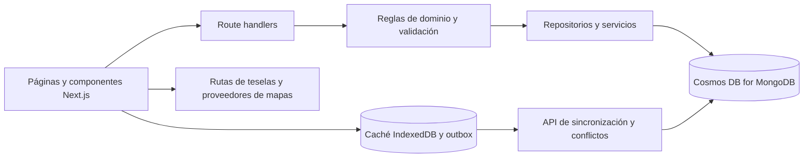

# GeoPin

GeoPin es una plataforma GIS de levantamiento en campo para equipos de ingeniería civil, urbanismo y arquitectura. Permite capturar puntos y perímetros de parcelas, completar formularios configurables, trabajar sin conexión y sincronizar los registros con un espacio de trabajo central.

**Guía del proyecto:** [documentación interactiva](/docs) · [README en inglés](README.md)

## Índice

- [Capacidades](#capacidades)
- [Tecnologías](#tecnologías)
- [Arquitectura](#arquitectura)
- [Modelo de datos](#modelo-de-datos)
- [Decisiones clave](#decisiones-clave)
- [Rutas](#rutas)
- [API](#api)
- [Estructura](#estructura-del-proyecto)
- [Configuración](#configuración)
- [Comandos](#comandos-de-desarrollo)
- [Mantenimiento](#notas-de-mantenimiento)
- [Licencia](#licencia)

## Capacidades

- Captura de parcelas sobre el mapa con GPS, puntos movibles y polígonos GeoJSON editables.
- Formularios de campo dinámicos según esquemas publicados por módulo.
- Caché y cola offline con IndexedDB, reintentos e informe de conflictos.
- Búsqueda, filtros, edición, revisión y exportación de parcelas.
- Administración de campañas y paneles de avance, cobertura de servicios y densidad.
- Importación CSV/Excel con análisis de duplicados y resolución de conflictos.
- Acceso por roles para encuestadores y administradores.
- Selección de capas y descarga opcional de teselas para trabajar sin conexión.

## Tecnologías

| Área | Tecnologías |
| --- | --- |
| Web | Next.js 16 App Router, React 19, TypeScript |
| UI | Tailwind CSS 4, shadcn/ui, Base UI, Lucide, tailwind-animations |
| Mapas | Leaflet y React Leaflet, GeoJSON |
| Servidor | Route handlers de Next.js, Better Auth |
| Datos persistentes | Driver de MongoDB contra Cosmos DB for MongoDB |
| Datos offline | IndexedDB con Dexie, service worker Serwist |
| Importación/exportación | Utilidades CSV y `xlsx`; generadores GeoJSON y shapefile |

## Arquitectura



La versión interactiva del diagrama, el explorador de colecciones, las decisiones y el índice de rutas están en [`/docs`](http://localhost:3000/docs).

## Modelo de datos

### Colecciones MongoDB

| Colección | Propósito | Campos e índices importantes |
| --- | --- | --- |
| `parcelas` | Punto o parcela capturada, con datos de cada módulo | `_id` replica el `id` de negocio; `ubicacion` GeoJSON, `geometria`, procedencia GPS, estado, campaña, `modulos`, versiones, fechas y autoría. Índices: `ubicacion` 2dsphere, `codigo` único sparse, `estado`, `levantamientoId`, `creadoEn`, `creadoPor`. |
| `schemas` | Un esquema dinámico publicado por módulo | `_id` replica `moduleId`; módulo, versión, campos, fecha de publicación y autor. Índice en `modulo`. |
| `levantamientos` | Campaña y total esperado de registros | `_id` replica `id`; nombre, ciudad, total esperado, creador y fecha. Índice en `ciudad`. |
| `user` | Cuentas de Better Auth | Administrada por Better Auth. GeoPin usa el rol para autorizar. |
| `session` | Sesiones de Better Auth | Administrada por Better Auth. |

Las definiciones exactas están en `lib/server/collections.ts`. Los productos Cosmos DB for MongoDB pueden diferir en las opciones de índices; el bootstrap reporta los errores individualmente y continúa creando los demás.

### Esquema resumido de una parcela

```json
{
  "_id": "id-parcela",
  "id": "id-parcela",
  "nombre": "Parcela 01",
  "ubicacion": { "type": "Point", "coordinates": [-66.90, 10.48] },
  "geometria": { "type": "Polygon", "coordinates": [] },
  "gps": { "fuente": "sensor", "precision": 8 },
  "estado": "pendiente",
  "levantamientoId": "id-campaña",
  "modulos": {
    "infraestructura": {
      "version": 1,
      "schemaVersion": 2,
      "datos": { "estado_vial": "regular" }
    }
  },
  "version": 1,
  "creadoEn": "ISO-8601",
  "creadoPor": "usuario@ejemplo.org"
}
```

GeoJSON usa coordenadas `[longitud, latitud]`. IndexedDB local guarda parcelas y esquemas en caché, además de elementos pendientes en la outbox; funciona como búfer de sincronización y no como fuente de verdad del servidor.

## Decisiones clave

### ¿Por qué MongoDB y no PostgreSQL?

La capa persistente desplegada es Cosmos DB for MongoDB, y el modelo actual encaja con documentos: los módulos son configurables, cada captura conserva la versión de esquema usada y una parcela puede escribirse como un documento. GeoJSON y un índice `2dsphere` permiten consultas espaciales. Usar el id de parcela como `_id` hace idempotentes los reintentos offline. Better Auth comparte el cliente MongoDB.

Esto describe la arquitectura actual; no es una afirmación basada en benchmarks. Los costos de la elección son explícitos: los documentos dinámicos requieren validación en la aplicación; las capacidades varían entre Cosmos RU y vCore. PostgreSQL con PostGIS sería una alternativa robusta para reportes relacionales, restricciones y analítica SQL. Una migración requeriría reemplazar persistencia, almacenamiento de autenticación, índices/consultas espaciales y la lógica de migración y sincronización.

### Otras decisiones

- **Captura offline:** IndexedDB y outbox protegen el trabajo si se pierde la red. El backoff y las versiones por módulo reducen colisiones al reintentar.
- **Concurrencia optimista:** versiones de parcela y módulo permiten detectar ediciones paralelas sin bloquear toda la campaña.
- **Campos configurables:** los esquemas publicados definen tipos y validación; cada captura conserva la versión del esquema que usó.
- **Interfaz mobile-first:** el mapa es la superficie principal en teléfono, con acciones flotantes y formulario inferior; en escritorio se mantiene un panel lateral.
- **Tema de interfaz:** la UI permite tema claro/oscuro mediante tokens; el mapa conserva una superficie cartográfica clara.

## Rutas

| Ruta | Propósito | Acceso |
| --- | --- | --- |
| `/` | Landing de producto | Público |
| `/login` | Iniciar sesión | Público; redirige a usuarios con sesión |
| `/campo` | Captura GIS y edición de polígonos | Usuario autenticado |
| `/listado` | Parcelas, filtros, edición, estados y exportación | Usuario autenticado; los encuestadores ven sus registros donde aplica |
| `/admin/dashboard` | Avance de campaña y analítica espacial/servicios | Permiso admin `levantamiento:gestionar` |
| `/admin/levantamientos` | Crear y administrar campañas | Permiso admin `levantamiento:gestionar` |
| `/admin/usuarios` | Cuentas, roles y estado de acceso | Permiso admin `usuarios:gestionar` |
| `/admin/esquema` | Configurar esquemas de captura | Permiso admin `esquema:editar` |
| `/admin/importar` | Importar CSV/Excel y resolver duplicados | Permiso admin `importar:ejecutar` |
| `/perfil` | Cambiar nombre y contraseña | Usuario autenticado |
| `/docs` | Documentación interactiva del sistema | Público |
| `/offline` | Respaldo sin conexión | Público/service worker |
| `/dashboard`, `/campo/lista` | Redirecciones de compatibilidad | Redirigen a rutas actuales |

## API

| Endpoint | Métodos | Función |
| --- | --- | --- |
| `/api/auth/[...all]` | GET, POST | Endpoints Better Auth |
| `/api/parcelas` | GET, POST | Listar y crear/sincronizar parcelas |
| `/api/parcelas/[id]` | GET, PATCH, DELETE | Consultar, editar o borrar parcela |
| `/api/parcelas/[id]/fusionar` | POST | Resolver/fusionar una parcela importada |
| `/api/sync` | POST | Procesar cambios pendientes offline |
| `/api/esquemas` | GET | Leer esquemas publicados |
| `/api/esquemas/[moduleId]` | PUT | Publicar esquema de módulo |
| `/api/levantamientos` | GET, POST | Listar y crear campañas |
| `/api/levantamientos/[id]` | PATCH | Actualizar campaña |
| `/api/dashboard` | GET | Agregados y puntos del mapa del dashboard |
| `/api/import` | POST | Analizar y aplicar una importación |
| `/api/export` | GET | Exportar registros seleccionados |
| `/api/capas` | GET | Configuración de capas base y overlays |
| `/tiles/[z]/[x]/[y]` | GET | Servir teselas configuradas |

Los handlers validan contratos y aplican sesión/permisos antes de llamar servicios y repositorios. Revisa el código de cada ruta para conocer parámetros y payloads vigentes.

## Estructura del proyecto

```text
app/                    Páginas App Router, API y rutas de teselas
components/ui/          Primitivas shadcn/ui
components/field/       Captura, lista, mapa y sincronización
components/admin/       Dashboard, importador y paneles administrativos
components/docs/        Visualizaciones interactivas de documentación
lib/domain/             Dominio puro, validación, GIS, sync e import/export
lib/field/              IndexedDB, caché, outbox y hooks de campo/mapa
lib/server/             Auth, entorno, Mongo, servicios y repositorios
scripts/                Seed, índices, verificación y herramientas de teselas
public/                 Íconos y recursos estáticos
```

## Configuración

1. Instala dependencias con `pnpm install`.
2. Copia `.env.example` a `.env.local` y define secretos y valores de conexión requeridos.
3. Configura proveedores de teselas y overlays opcionales según los comentarios de `.env.example`.
4. Para preparar índices, ejecuta `pnpm db:indexes`. Siembra esquemas/usuarios solo en un entorno donde corresponda.

No subas `.env.local` ni credenciales de producción. `lib/server/env.ts` valida la configuración de servidor. Solo las variables con prefijo `NEXT_PUBLIC_` se exponen al bundle del navegador.

## Comandos de desarrollo

```bash
pnpm dev              # Inicia Next.js localmente
pnpm build            # Genera el build de producción
pnpm start            # Sirve el build de producción
pnpm lint             # Ejecuta ESLint
pnpm typecheck        # Revisa TypeScript de la app y service worker
pnpm test             # Ejecuta Vitest
pnpm db:indexes       # Asegura los índices Mongo declarados
pnpm seed             # Crea esquemas/admin iniciales (revisa opciones del script)
pnpm tiles:generar    # Genera datos de teselas configurados
```

## Notas de mantenimiento

- Mantén reglas de negocio puras en `lib/domain`, independientes de React y del driver de base de datos.
- Deja el acceso a datos en repositorios y la orquestación en servicios; los route handlers son la frontera HTTP.
- Al modificar payloads, actualiza `lib/api/contracts.ts`, el handler y las pruebas de dominio pertinentes.
- Al cambiar documentos, actualiza tipos, persistencia, índices y esta guía de datos.
- No retires rutas de compatibilidad ni tipos antiguos del mapa sin comprobar primero sus consumidores.
- Consulta `AGENTS.md` antes de cambiar convenciones de Next.js. El proyecto utiliza App Router y la documentación instalada está en `node_modules/next/dist/docs/`.

## Licencia

GeoPin se distribuye bajo la licencia MIT. Consulta [LICENSE.md](LICENSE.md) para
el texto original en inglés y [LICENCIA.md](LICENCIA.md) para su traducción al español.
