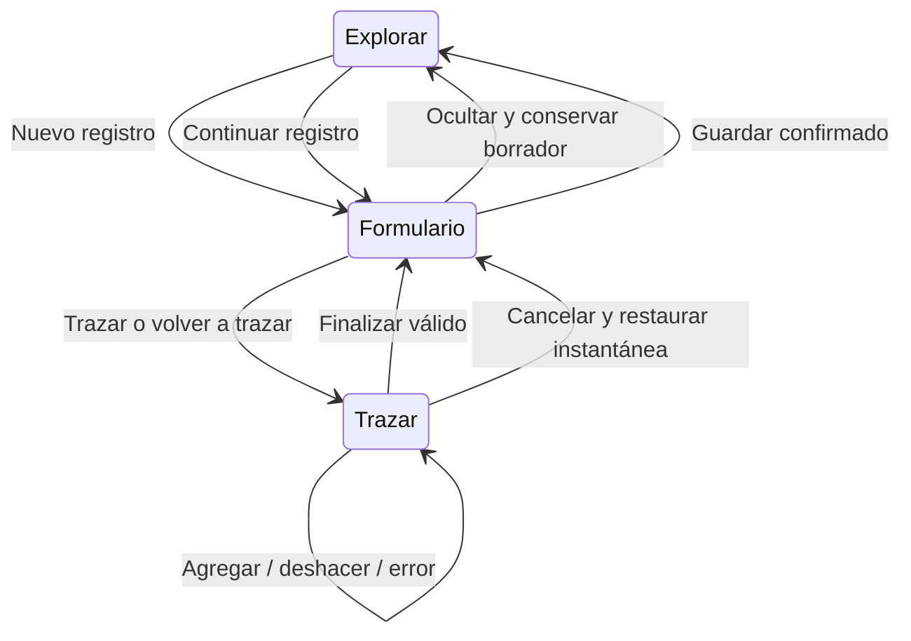

# Plan ejecutable de implementación

Estado: pendiente. Cada paso requiere revisión del código vigente antes de editar. Leer las guías locales Next.js exigidas por AGENTS.md antes de escribir código.

## Fase 1 — Borrador único y transiciones

- Elevar el estado editable de `FormularioParcela` a un propietario estable en la ruta o un hook de sesión de captura. Compartirlo entre tamaños de pantalla; conservar campos dinámicos, errores y módulo activo.
- Diferenciar ocultar formulario, cancelar trazado y descartar registro. Ocultar no elimina datos. Reiniciar sólo tras guardado confirmado o descarte explícito.
- Tomar una instantánea de geometría y área manual antes de iniciar/retrazar. Restaurarla al cancelar; reemplazarla sólo al completar geometría válida. La confirmación actual que borra el área manual debe aplazar ese borrado hasta el cierre válido.
- Coordinar todas las entradas a trazado, incluidos Reemplazar y Volver a trazar; evitar arreglar sólo un botón.
- Mantener en memoria el estado previo al abrir navegación. Cerrar navegación devuelve a la tarea. Abandonar ruta o cerrar sesión con datos pendientes requiere resolver conservar/cancelar/descarte explícito; la cola offline ya guardada no debe confundirse con un formulario sin guardar.



## Fase 2 — Superficie de medición

Archivos principales: `app/campo/page.tsx`, `GeometriaPanel.tsx`, `PolygonEditor.tsx`, `MapView.tsx`, `use-poligono.ts`.

- En móvil, cerrar formulario y teclado al entrar en trazado; suspender seguimiento automático del centro GPS durante esa interacción.
- Añadir barra no modal anclada al borde inferior con safe area: resumen de vértices y medidas, Deshacer, Cancelar y Finalizar. Finalizar deshabilitado antes de tres vértices; validaciones geométricas existentes siguen siendo autoridad.
- No renderizar Nuevo registro mientras se traza. Recoger Capas al entrar y permitir abrirlas explícitamente sin tapar las acciones de trazado.
- Finalizar exitoso: volver al formulario con medidas y atributos conservados. Error: seguir en mapa, anunciar causa y permitir corregir. Cancelar: volver al formulario con instantánea restaurada.
- Tras ocultar un formulario con datos, el botón debe decir Continuar registro para comunicar que existe borrador.
- Componer controles en un contenedor de layout con separación, evitando offsets independientes para Capas y acciones. Mantener atribución del mapa visible.
- Definir mapa < controles de mapa < formulario < navegación modal; usar portal para navegación. Evitar escaladas arbitrarias de z-index.
- En escritorio conservar mapa utilizable junto al formulario; llevar acciones de dibujo a una posición visible y permitir colapsar panel de captura. Invalidar tamaño de Leaflet cuando cambie el espacio disponible.

## Fase 3 — Navegación responsive

Archivos principales: `components/NavBar.tsx`, nuevo componente de navegación compartida y primitivas UI necesarias. Revisar consumidores antes de eliminar utilidades de avatar.

- Unificar enlaces por rol en una fuente compartida para drawer y sidebar.
- Sustituir dropdown móvil por drawer inferior accesible, con título Menú y cierre visible. Retirar user-avatar; Perfil permanece como enlace.
- Orden del contenido: Cerrar sesión → Separator → enlaces del rol → Perfil. Tema puede quedar en cabecera; evitar duplicarlo sin necesidad.
- Encabezado con logo y botón Menú; entradas táctiles amplias, ruta activa con `aria-current`, lista vertical y scroll interno cuando el alto sea insuficiente.
- Propuesta inicial: drawer por debajo de `lg`, sidebar desde `lg`; validar 768–1024 px antes de fijar breakpoint. Sidebar no debe reducir el mapa por debajo de un tamaño usable junto al formulario de escritorio.
- Usar primitivas shadcn compatibles con Base UI instalado. Comprobar portal, título accesible, foco inicial, Escape, cierre exterior y retorno de foco al disparador. No bloquear mapa con un overlay invisible tras cerrar.
- Menú de navegación semántico con enlaces, no roles de menú de aplicación por defecto. Al abrirlo, pausar interacción con el mapa; al cerrarlo, restaurar el modo previo.
- Cerrar sesión: mostrar estado pendiente, impedir dobles envíos y comunicar fallo. Mantener sesión/ruta si falla. Resolver borrador pendiente antes del cierre efectivo.

Esquema móvil propuesto:

```text
Captura / medición                  Menú abierto
┌──────────────────────┐           ┌──────────────────────┐
│ GeoPin          Menú │           │ Fondo inerte         │
│ GPS / sincronización │           ├──────────────────────┤
│                      │           │ Menú              ×  │
│ MAPA INTERACTIVO     │           │ Cerrar sesión        │
│                      │           │ ──────────────────── │
│ Capas (recogido)      │           │ Capturar             │
│ 4 vértices · área    │           │ Listado / Mis datos  │
│ Deshacer · Cancelar  │           │ Opciones según rol   │
│ Finalizar            │           │ Docs · Perfil        │
└──────────────────────┘           └──────────────────────┘
```

## Entregas posteriores

Primero borrador y captura; después navegación responsive; finalmente validación del conjunto y documentación de comportamiento real. Cada PR debe indicar verificaciones realizadas y pendientes. No ejecutar automáticamente estos planes por el hecho de existir en el repositorio.
